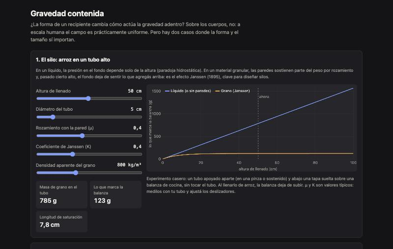

<div align="center">

# Gravity in a Box

**Gravedad contenida.** Qué cambia (y qué no) con la forma del recipiente: el efecto Janssen en un tubo de arroz y las fuerzas de marea en el ascensor de Einstein.

[**▶ Probala en vivo**](https://loiaconobruno.github.io/gravity-in-a-box/) · [Cómo funciona](#cómo-funciona) · [Limitaciones](#limitaciones)

[](https://github.com/LoiaconoBruno/gravity-in-a-box/actions/workflows/tests.yml)


[](LICENSE)



</div>

Página interactiva que separa las dos preguntas de la idea "escala vertical y gravedad contenida" y responde la física: **¿la forma de un recipiente cambia cómo actúa la gravedad adentro?**

Sobre un cuerpo, no: a escala humana el campo de la Tierra es prácticamente uniforme. Pero hay dos casos donde la forma y el tamaño sí importan, y la página los calcula:

1. **El silo (efecto Janssen).** En un tubo alto lleno de grano, las paredes sostienen parte del peso y la presión en el fondo se satura. En un líquido no pasa: la presión depende solo de la altura.
2. **La caja cerrada (el ascensor de Einstein).** Adentro de una caja sin ventanas, la gravedad uniforme no se distingue de una aceleración. Lo que la delata son las **fuerzas de marea**: dos bolas que caen lado a lado se acercan y dos bolas una sobre otra se separan.

## Por qué

La idea original mezcla percepción y física. Separarlas es lo que la hace avanzar: esta página contesta la parte física con números concretos y deja la percepción como próximo paso.

## Instalación

No hace falta instalar nada: **[abrila en el navegador](https://loiaconobruno.github.io/gravity-in-a-box/)**.

Para usarla sin conexión o modificarla:

```bash
git clone https://github.com/LoiaconoBruno/gravity-in-a-box.git
```

Después abrí `index.html` con doble clic. No hay dependencias ni paso de build. Para correr los tests hace falta Node 18 o más nuevo:

```bash
npm test
```

## Uso

Abrí la [demo en vivo](https://loiaconobruno.github.io/gravity-in-a-box/) o `index.html` con doble clic.

Ejemplo:

1. **Silo.** Al abrir, el tubo mide 5 cm de diámetro y está lleno de arroz hasta 50 cm (densidad aparente 800 kg/m³, μ = 0,4, K = 0,4). Hay **785 g** de arroz, pero la balanza marca **123 g**: a partir de unos **7,8 cm** de altura (la longitud de saturación), el fondo casi no siente lo que se agrega arriba.
2. Subí el diámetro a 20 cm: la balanza pasa a marcar **6,27 kg** y la saturación llega recién a los 31,2 cm. Cuanto más angosto el tubo, más peso sostienen las paredes.
3. **Caja.** Con una caja de 1 m en la superficie, g cambia **3,14 partes en 10 millones** entre el piso y el techo. En 10 s de caída libre, dos bolas separadas 1 m se acercan **77,1 µm** y las de arriba y abajo se separan **154,1 µm**. El período de Schuler es de **84,3 min**.
4. Agrandá la caja hacia los miles de kilómetros: la página avisa que ahí la forma de la caja ya importa.

## Cómo funciona

**Janssen (1895).** Para un tubo de diámetro D, rozamiento con la pared μ y coeficiente de Janssen K (cociente entre la presión horizontal y la vertical):

```
P(z) = ρ·g·λ · (1 − e^(−z/λ)),   λ = D / (4·μ·K)
```

Lo que marca una balanza que solo sostiene el fondo es `P·área / g`. En un líquido, `P = ρ·g·z`.

**Marea.** Para una caja en caída libre a distancia r del centro de la Tierra, con `ω² = GM / r³`:

- diferencia de g entre piso y techo: `Δg/g = 2h / r`;
- bolas lado a lado (separación w): `w·(1 − cos ω·t)`;
- bolas una sobre otra (separación h): `h·(cosh(√2·ω·t) − 1)`.

`2π/ω` es el período de Schuler (≈ 84 minutos en la superficie).

La lógica está en `src/caja.js`, sin DOM, y se testea con:

```bash
npm test
```

## Limitaciones

- μ y K del arroz son valores típicos, no medidos: dependen del material del tubo, del grano y de cómo se llena. Conviene medirlos con el propio tubo.
- El modelo de Janssen supone un material que ya deslizó contra las paredes y una presión uniforme en cada sección. Los silos reales tienen efectos dinámicos al vaciarse.
- Las fórmulas de marea son de primer orden: valen para cajas chicas frente al radio de la Tierra.
- No toca la parte de percepción de la idea.

## Próximos pasos

- Hacer el experimento casero con arroz y una balanza de cocina, y ajustar μ y K a lo medido.
- Diseñar la prueba de percepción: estimar distancias adentro de cajas de distintas proporciones (habitación de Ames).
- Escribir la pregunta central en una sola oración y decidir el formato: ensayo con experimentos o serie de videos cortos.

## Licencia

MIT
